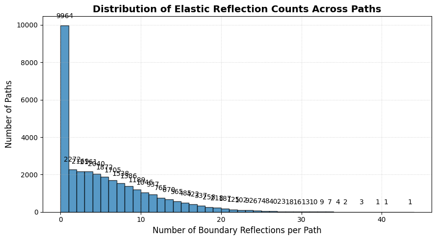
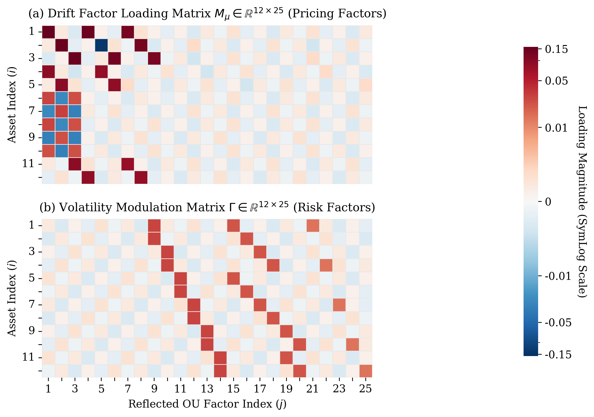

# Deep BSDE Solver for Constrained Mean-Variance Portfolio Selection under Reflected Factor Dynamics

This repository contains the open-source companion code for the paper. **"Constrained Mean-Variance Portfolio Selection under Reflected Factor Dynamics: Stochastic Riccati Equations, Neumann Problems, and a Deep Solver"**.

## Overview

A Deep BSDE framework for solving high-dimensional Extended Stochastic Riccati Equations (ESREs) arising in constrained continuous-time mean-variance portfolio selection. The solver models latent market states via a reflected Ornstein-Uhlenbeck factor process on a bounded spherical domain and solves the logarithmically transformed quadratic BSDEs under homogeneous Neumann boundary conditions.

## Repository Structure

```text
DeepBSDE_Reflected_OU/
├── README.md
├── requirements.txt
├── StateDependentAssetModel_GPU.py
├── LambdaNetwork.py
├── OnlineDeepLnSRESolver.py
├── lnSRE_Equation_plus.py
├── lnSRE_Equation_minus.py
├── ConstrainedLnSRE_LSQMC_P_Plus.py
├── ConstrainedLnSRE_LSQMC_P_Minus.py
└── notebooks_and_results/
    ├── 01_coefficients_and_diagnostics.ipynb
    ├── 02_training_history.ipynb
    ├── 03_oos_evaluation.ipynb
    └── (Trained checkpoints & figures)

```

## Core Modules

- **`StateDependentAssetModel_GPU.py`**: GPU-accelerated Monte Carlo simulator for the reflected Ornstein-Uhlenbeck factor process and state-dependent multi-asset dynamics, providing specular boundary reflection, Skorokhod reflection increments, and trajectory diagnostics.


- **`LambdaNetwork.py`**: Time-step decoupled neural network architecture for approximating the BSDE martingale integrand.


- **`OnlineDeepLnSRESolver.py`**: Online Deep BSDE training and evaluation engine incorporating geometry-aware Neumann boundary projection, Skorokhod local-time compensation, and multi-stage optimization.


- **`lnSRE_Equation_plus.py` / `lnSRE_Equation_minus.py`**: Drift generator evaluators for the positive and negative log-transformed ESREs, featuring a batched GPU FISTA solver for the cone-constrained Hamiltonian.


- **`ConstrainedLnSRE_LSQMC_P_Plus.py` / `ConstrainedLnSRE_LSQMC_P_Minus.py`**: Backward Least-Squares Monte Carlo (LSQMC) estimators via polynomial ridge regression, providing fast initial value anchors for warm-starting the Deep BSDE solver.


## Workflow & Quick Start

1. **Environment Setup**
   Install the required dependencies via `requirements.txt`. All neural network training experiments were conducted on Google Colab using an NVIDIA L4 GPU, where the Deep BSDE solver converges within 1 to 2 hours depending on parameter settings.
2. **Execution Pipeline**
The standard training workflow consists of two stages:
- **Stage 1 (LSQMC Pre-estimation of SRE Initial Value $`\check{P}_{\pm}(0)`$)**: Simulate a large batch of reflected factor paths using `StateDependentAssetModel_GPU` and run backward polynomial ridge regression (`ConstrainedLnSRE_LSQMC_P_Plus` / `P_Minus`) from $`\check{P}_{\pm}(T)=0`$ to obtain a preliminary scalar estimate for the log-SRE initial value $`\check{P}_{\pm}(0)`$.
- **Stage 2 (Two-Phase Online Deep BSDE Training)**: Initialize the solver's learnable scalar parameter $`\check{P}_{\pm}(0)`$ (`self.P0`) at the LSQMC estimate. In **Phase 1**, freeze $`\check{P}_{\pm}(0)`$ and train only `LambdaNetwork` to approximate the adjoint process $`\check{\Lambda}_{\pm,t}`$. In **Phase 2**, unfreeze $`\check{P}_{\pm}(0)`$ and jointly optimize the scalar initial value $`\check{P}_{\pm}(0)`$ alongside the parameters of `LambdaNetwork` to match the terminal condition $`\check{P}_{\pm}(T)=0`$.


## Reproducing Paper Results

The notebooks in `notebooks_and_results/` reproduce all diagnostics, training histories, and out-of-sample evaluations reported in the paper.

### 1. Synthetic Market Specification & Reflection Diagnostics (`01_coefficients_and_diagnostics.ipynb`)

This notebook configures a synthetic linear-affine state-return and stochastic volatility market where $d=25$ reflected Ornstein-Uhlenbeck (ROU) state factors $V_t$ evolve inside the closed unit ball ($R = 1.0$) and drive the drift $\mu(V_t) = \mu_0 + M_\mu V_t$ and volatility $\sigma(V_t) = \text{diag}(\mathbf{1}_{12} + \Gamma V_t)\sigma_0$ of $N=12$ risky assets. 

Calling `StateDependentAssetModel_GPU.simulate` and the built-in diagnostic methods (`analyze_factors` and `analyze_scenarios`) generates the forward trajectories, compares empirical asset moments against steady-state analytical benchmarks, and outputs the boundary reflection statistics:

```text
------------------------------------------------------------
💡 Spherical Boundary Reflection Statistics:
- Domain boundary radius (Radius)          : 1.0
- Max reflections per path                 : 43
- Mean reflections per path                : 5.08
- Percentage of paths with zero reflection : 30.41%
------------------------------------------------------------
```

With 69.59% of the simulated paths experiencing at least one boundary reflection (30.41% with zero reflection), averaging 5.08 reflections per path, the distribution of elastic reflection counts across paths is shown below:



In this synthetic market, the 25 latent factors are structurally partitioned into two functional groups: the leading pricing factors ($j=1,\dots,9$) govern expected asset returns through sparse block loadings and alternating long-short hedging exposures ($i=6,\dots,10$), while the remaining risk factors ($j=9,\dots,25$) modulate asset volatilities through three diagonal band structures (pairwise shared, grouped, and cross-asset exposures). The notebook plots the symmetric logarithmic heatmaps for the drift factor loading matrix $M_\mu \in \mathbb{R}^{12 \times 25}$ and the volatility modulation matrix $\Gamma \in \mathbb{R}^{12 \times 25}$ to visualize this factor-asset correspondence:




### 2. Training Dynamics (`02_training_history.ipynb`)

This notebook reproduces the training history plots for the logarithmically transformed equations $`\check{P}_+`$ and $`\check{P}_-`$ reported in Figure 2 of the paper.

### 3. Out-of-Sample Evaluation (`03_oos_evaluation.ipynb`)

This notebook loads the trained checkpoints and reproduces the out-of-sample trajectory evolution plots (Figure 3) and terminal statistics (Table 1) for $`\check{P}_+`$ and $`\check{P}_-`$ reported in the paper.


## Citation

```bibtex
@ARTICLE{2026arXiv261106538H,
       author = {{Huang}, Zhecheng and {Shao}, Guojiang and {Zhang}, Qi},
        title = "{Constrained Mean Variance Portfolio Selection under Reflected Factor Dynamics: Stochastic Riccati Equations, Neumann Problems,and a Deep Solver}",
          doi = {10.48550/arXiv.2611.06538},
}


```
